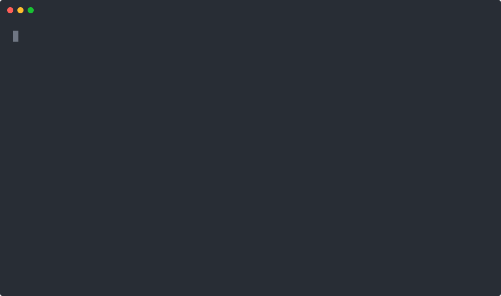

# dAppBooster installer

Scaffolds a new project from [dAppBooster](https://dappbooster.dev/), our blockchain boilerplate for EVM projects.

Looking for Canton? It has its own installer: [`create-canton-dappbooster`](https://github.com/BootNodeDev/canton-dappbooster/tree/main/canton-create).

## Requirements

- Node >= 24.15.0
- pnpm

## Interactive mode



```shell
pnpm dlx dappbooster
```

The wizard guides you through the choices: project name, installation mode and features.

## Non-interactive mode (agents & CI)

| Flag | Purpose |
|---|---|
| `--name <name>` | Project directory name (`/^[a-zA-Z0-9_][a-zA-Z0-9_-]*$/`, so no leading dash) |
| `--mode <full\|custom>` | `full` installs every feature; `custom` needs `--features` |
| `--features <a,b,c>` | Comma-separated feature keys (custom mode only) |
| `--info` | Print the features as JSON and exit |
| `--ni`, `--non-interactive` | Force non-interactive mode. It turns on by itself when stdout is not a TTY |
| `--help` | Show the usage text |
| `--version` | Show the installer version |

Example: discover the features first, then install.

```shell
pnpm dlx dappbooster --info
pnpm dlx dappbooster --ni --name my_dapp --mode full
pnpm dlx dappbooster --ni --name my_dapp --mode custom --features demo,subgraph
```

**Feature options:**

| Feature | Key | Default | Description |
|---|---|---|---|
| Component Demos | `demo` | ✓ | Component demos and example pages |
| Subgraph support | `subgraph` | ✓ | TheGraph subgraph integration |
| Typedoc | `typedoc` | ✓ | TypeDoc API documentation generation |
| Vocs | `vocs` | ✓ | Vocs documentation site |
| Husky | `husky` | ✓ | Git hooks with Husky, lint-staged, and commitlint |

## Installer development

```shell
git clone git@github.com:BootNodeDev/dAppBoosterInstallScript.git
cd dAppBoosterInstallScript
nvm use
corepack enable
pnpm i
pnpm build
node dist/cli.js
```
